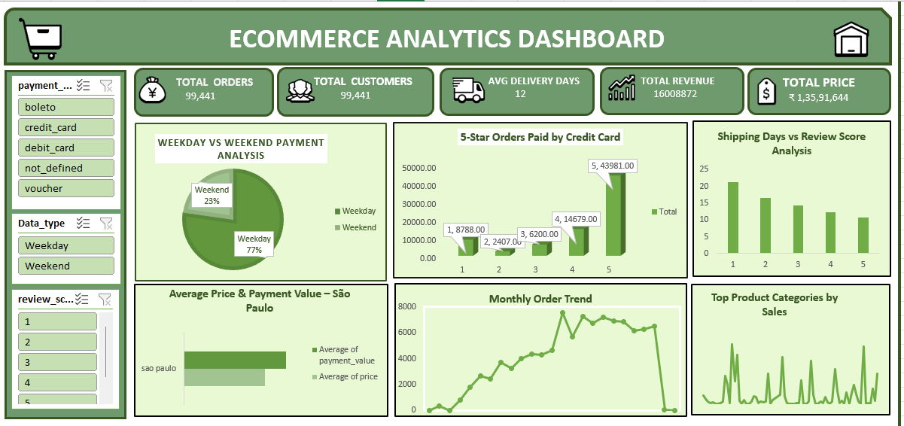
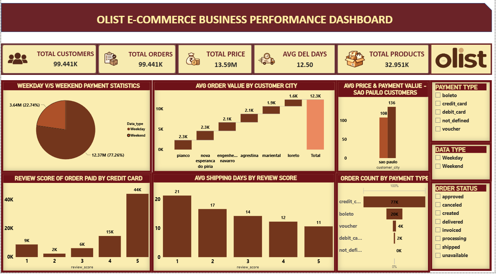

# Olist E-Commerce Business & Data Analytics Project

## Project Overview
An end-to-end E-Commerce Business and Data Analytics project using the Olist E-Commerce dataset.

This project focuses on analysing sales performance, customer behaviour, order trends, payment patterns, and delivery performance using multiple data analytics tools.

## Tools & Technologies
- Excel – Data Analysis and Dashboard
- SQL – Data Extraction and Business Queries
- Python – Data Cleaning, EDA and Analysis
- Power BI – Interactive Dashboard
- Tableau – Data Visualization

## Project Files
| File | Description |
|---|---|
| Excel | E-Commerce dataset and analysis |
| SQL | Business queries and analysis |
| Python | Data cleaning and exploratory analysis |
| Power BI | Interactive business dashboard |
| Tableau | Interactive visualization workbook |

## Dashboard Previews

### Excel Dashboard

### Power BI Dashboard

### Tableau Dashboard

## Key Analysis Areas
- Sales and revenue analysis
- Customer and order analysis
- Payment analysis
- Delivery performance
- Product and seller analysis
- Customer review analysis
- Monthly order trends

## Author
**Anasta Chandran**

Aspiring Business Analyst | Business Analytics

